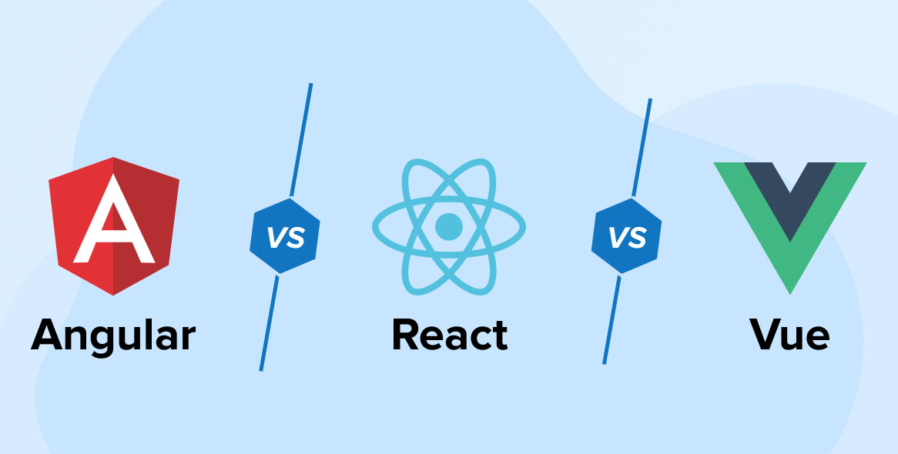
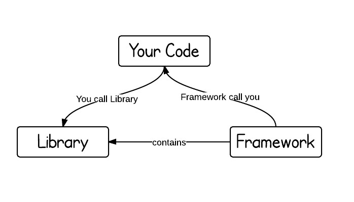
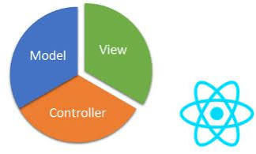
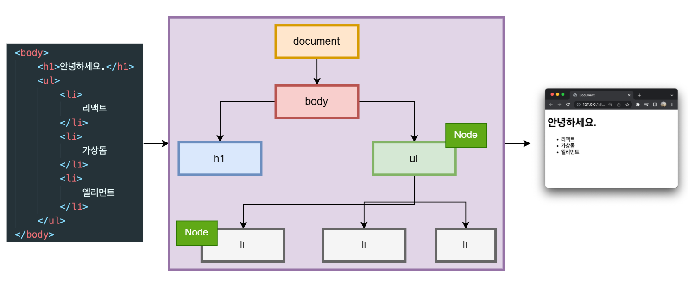
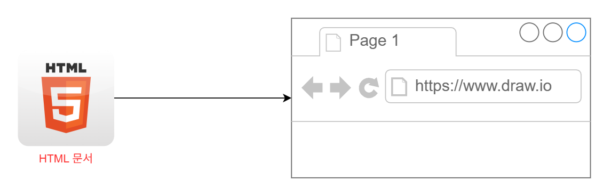
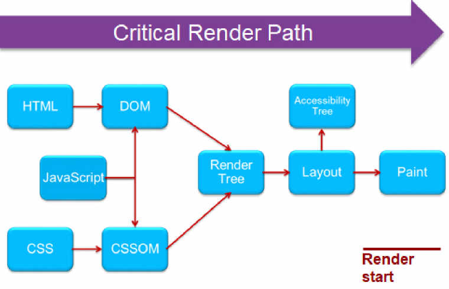
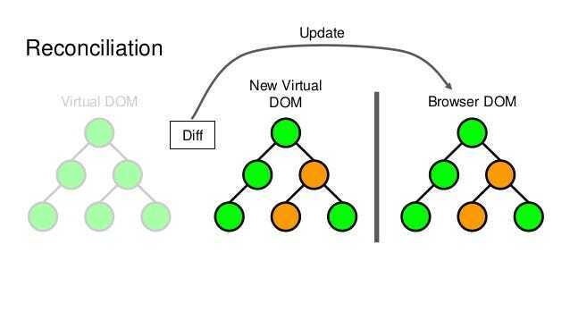
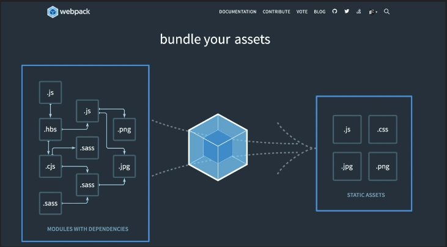

# React Notes

## 1. React 기초

### 1.1 React란 무엇인가?

**React는 사용자 인터페이스(UI)를 만들기 위한 JavaScript 라이브러리이다.**

- 인터랙션이 많은 웹 애플리케이션 개발에 주로 사용된다.
- 컴포넌트(Component) 기반으로 UI를 구성한다.
- Virtual DOM을 사용하여 효율적으로 화면을 업데이트한다.

#### React vs Vue vs Angular



- React → 라이브러리(Library)
- Vue → 프레임워크(Framework)
- Angular → 프레임워크(Framework)

#### 프레임워크와 라이브러리



##### Framework

- 애플리케이션 개발에 필요한 대부분의 기능을 제공한다.
- 프레임워크가 개발자의 코드를 호출한다.
- 예: Spring, Angular

##### Library

- 특정 기능을 제공하는 도구이다.
- 개발자가 필요할 때 호출하여 사용한다.
- 예: React, Axios, Lodash

#### React는 왜 라이브러리인가?

React는 **UI 렌더링만 담당**한다.



그 외 기능은 별도의 라이브러리를 사용한다.

- 라우팅 → React Router
- 상태 관리 → Redux, MobX, Recoil, Zustand
- HTTP 통신 → Axios
- 빌드 → Vite, Webpack
- 테스트 → Jest, Vitest

따라서 React는 완전한 프레임워크가 아닌 **UI 개발 라이브러리**이다.

---

### 1.2 React를 사용하는 이유

- 상대적으로 배우기 쉽다.
- 컴포넌트 기반으로 재사용성이 높다.
- 관련 라이브러리와 생태계가 풍부하다.
- 대규모 서비스에서 검증되었다.
- 커뮤니티가 크고 참고 자료가 많다.

---

### 1.3 React 컴포넌트

컴포넌트(Component)는 React 애플리케이션을 구성하는 **최소 단위의 UI 조각**이다.

React는 여러 컴포넌트를 조합하여 화면을 구성한다.


#### 클래스형 컴포넌트

- ES6 클래스를 사용한다.
- 과거에 주로 사용되었다.

#### 함수형 컴포넌트

- 함수를 사용하여 작성한다.
- 현재 React 개발의 표준 방식이다.
- Hooks를 사용할 수 있다.

---

### 1.4 브라우저 렌더링과 Virtual DOM

#### 브라우저 렌더링 과정

리액트의 주요 특징 중 하나는 **가상(Virtual)돔**을 사용한다는 것이다.

#### DOM(Document Object Model)

DOM은 HTML 문서를 브라우저가 이해할 수 있도록 트리 구조의 객체로 표현한 것이다.

즉, JavaScript가 웹 페이지의 요소에 접근하고 조작할 수 있도록 만든 객체 모델이다.




#### DOM 조작

DOM API를 이용하여 요소를 조회하거나 수정할 수 있다.


#### 웹 페이지 빌드 과정(Critical Rendering Path CRP)

브라우저는 HTML을 받아 화면에 표시하기까지 다음 과정을 거친다.





1. **DOM Tree 생성**
   - HTML을 파싱하여 DOM 생성

2. **CSSOM 생성**
   - CSS를 파싱하여 CSSOM 생성

3. **Render Tree 생성**
   - DOM과 CSSOM을 결합
   - 화면에 표시될 요소와 스타일 정보 포함

4. **Layout (Reflow)**
   - 각 요소의 크기와 위치 계산

5. **Paint**
   - 실제 화면에 렌더링


#### DOM 조작의 문제점

사용자의 인터랙션으로 DOM이 변경되면 브라우저는 다시 렌더링 과정을 수행한다.  
인터랙션이 많은 애플리케이션에서는 이러한 작업이 반복되어 성능 저하가 발생할 수 있다.
특히 Layout과 Paint 과정의 비용이 크다.

#### Virtual DOM

이러한 문제를 해결하기 위해 React는 Virtual DOM을 사용한다.  
Virtual DOM은 실제 DOM을 JavaScript 객체 형태로 메모리에 저장한 가상 복사본이다.

특징

- 실제 DOM과 동일한 구조를 가진다.
- 메모리에서 동작한다.
- 직접 화면을 변경하지 않는다.

#### Virtual DOM 동작 과정



리액트에서는 항상 렌더링 이전의 객체( Virtual DOM)와 렌더링 이후의 객체( Virtual DOM)를 가지고 있음. 

State(데이터)가 바뀌면  Virtual DOM이 새로 생성됨.

##### Diffing
이전 Virtual DOM과 새로운 Virtual DOM을 비교하여 변경된 부분을 찾는 과정이다.

##### Reconciliation

Diffing 결과를 실제 DOM에 반영하는 과정이다.

React는 변경된 부분만 업데이트하여 불필요한 DOM 조작을 줄인다.

#### Batch Update

React는 여러 State 변경을 하나로 묶어서 처리한다.

```jsx
setCount(count + 1);
setName("Kim");
setAge(20);
```

위와 같이 여러 상태가 변경되어도 React는 가능한 한 한 번의 렌더링으로 처리한다.

---

### 1.5 Node.js

React 프로젝트를 생성하고 개발하기 위해서는 Node.js가 필요하다.

> Node.js를 설치하면 npm(Node Package Manager)도 함께 설치된다.

#### Node.js란?

Node.js는 Chrome의 V8 엔진 기반 JavaScript 런타임이다.

브라우저 밖에서도 JavaScript를 실행할 수 있게 해준다.

#### React에서 Node.js가 필요한 이유

React는 브라우저에서 실행되지만, 개발 과정에서 사용하는 도구들이 Node.js 위에서 동작한다.


- npm 패키지 관리
- Vite 실행
- Webpack 번들링
- Babel 코드 변환
- 개발 서버 실행

---

### 1.6 리액트 앱 설치하기

#### Webpack

오픈 소스 자바스크립트 모듈 번들러로써 여러개로 나눠져 있는 파일들을 하나의 자바스크립트 코드로 압축하고 최적화하는 라이브러리



- 장점
  1.  여러 파일의 자바스크립트 코드를 압축하여 최적화 할 수 있기 때문에 로딩에 대한 네트워크 비용을 줄일 수 있다.
  2.  모듈 단위로 개발이 가능하여, 가독성과 유지보수가 쉽다.

#### Babel

최신 자바스크립트 문법을 지원하지 않는 브라우저들을 위해서 최신 문법을 구현 브라우저에서도 돌 수 있게 변환 시켜주는 라이브러리

#### Vite을 사용하여 리액트 앱 설치하기

React 앱을 빠르게 만들어주는 도구. 

**설치 명령어**
  - npm
    - 필요한 오픈소스 코드(패키지)를 다운로드하는 도구
  - npx
    - 컴퓨터에 설치 없이 최신 버전을 다운로드 후 실행, 삭제
    - 휘발성 저장(일회성)
  - vite
    - 프로젝트의 초기 폴더 구조와 뼈대를 만들어주는 빌드 도구
    - 프로젝트 생성 시에만 임시 실행
```bash
npm create vite@latest
# ↓ 내부적으로 아래와 동일하게 동작
npx create-vite@latest
```

```bash
# 실행하면 아래 질문이 나옴
? Project name:       # 프로젝트 이름 (예: my-app)
? Select a framework: # React 선택
? Select a variant:   # JavaScript 선택 (처음엔 JS 추천)
```

## 2. 간단한 To-Do 앱 만들며 리액트 익히기

### 2.1 기본 폴더 구조

```text
my-project/
├── public/                 # 정적 리소스 (이미지, 폰트 등, 빌드 시 그대로 복사됨)
│   └── vite.svg            # 기본 Vite 아이콘
├── src/                    # 실제 개발을 진행하는 소스 코드 폴더
│   ├── assets/             # 이미지, CSS 등 정적 에셋 파일
│   ├── App.css             # 기본 스타일 시트
│   ├── App.tsx (or .jsx)   # 루트 컴포넌트
│   ├── main.tsx (or .js)   # 애플리케이션 진입점(Entry point)
│   └── index.css           # 전역 스타일 시트
├── .gitignore              # Git 버전 관리에서 제외할 파일 설정
├── index.html              # 싱글 페이지 애플리케이션(SPA)의 기본 HTML 템플릿
├── package-lock.json       # 의존성 패키지의 정확한 버전 고정 파일
├── package.json            # 프로젝트 정보 및 의존성(라이브러리) 목록
├── README.md               # 프로젝트 설명 문서
└── vite.config.ts (or .js) # Vite 프로젝트의 핵심 설정 파
```
#### src 폴더

대부분의 리액트 소스 코드들을 이곳에 작성
Webpack은 src 폴더내의 파일만 처리함.

#### package.json

해당 프로젝트에 대한 정보들이 들어있다. 

```json
{
  "name": "react-todo-app",
  "private": true,
  "version": "0.0.0",
  "type": "module",
  "scripts": {
    "dev": "vite",
    "build": "vite build",
    "lint": "eslint .",
    "preview": "vite preview"
  },
  "dependencies": {
    "react": "^19.2.6",
    "react-dom": "^19.2.6"
  },
  "devDependencies": {
    "@eslint/js": "^10.0.1",
    "@types/react": "^19.2.14",
    "@types/react-dom": "^19.2.3",
    "@vitejs/plugin-react": "^6.0.1",
    "eslint": "^10.3.0",
    "eslint-plugin-react-hooks": "^7.1.1",
    "eslint-plugin-react-refresh": "^0.5.2",
    "globals": "^17.6.0",
    "vite": "^8.0.12"
  }
}
```

- scripts  
  - 리액트 앱 실행, 빌드, 테스트 등의 스트립트가 명시되어 있음
  - 프로젝트에서 자주 실행해야하는 명령어를 scripts로 작성해두면 npm명령어로 실행 가능
- dependencies  
  - 운영 환경에서 필요한 라이브러리와 그 버전들이 명시됨
- devDependencies
  - 개발 환경에서 사용한 라이브러리와 그 버전들이 명시됨

---

### 2.2 React App 실행해보기 (npm run dev)

```bash
# package.json기반 필수 라이브러리 일괄 설치
npm install

# 로컬 개발 서버 구동 (실시간 화면 확인)
npm run dev
```

### 2.3 SPA(Single Page Application)

`index.html`

```html

```


---

## 3. React를 위한 JavaScript 필수 개념

### 3.1 계산된 속성명 (Computed Property Name)

객체 리터럴의 키에 `[ ]`를 쓰면 **변수에 담긴 값을 키(속성명)로 사용**할 수 있다.

```js
const key = "email";
const obj = { [key]: "a@a.com" };      // { email: "a@a.com" }
const obj2 = { ["user" + 1]: "철수" };  // { user1: "철수" } (표현식도 가능)
```

`[ ]` 없이 `{ key: "a@a.com" }`라고 쓰면 키가 변수 값이 아니라 문자 그대로 `"key"`가 된다.

#### `[ ]`가 쓰이는 위치별 의미

| 위치 | 예시 | 의미 |
|---|---|---|
| 객체 리터럴의 키 | `{ [key]: v }` | 변수 값을 키로 사용 |
| 변수 뒤 | `obj[key]`, `arr[0]` | 속성/요소 접근 |
| 값 자리 | `[1, 2, 3]` | 배열 생성 |
| 선언의 왼쪽 | `const [a, b] = arr` | 배열 구조 분해 |

겉모양은 같지만 **어디에 쓰였는지**로 구분한다.

#### React에서의 활용: 여러 input을 하나의 state로 관리

```jsx
const [form, setForm] = useState({ name: "", email: "" });

function handleChange(e) {
  const { name, value } = e.target;            // input의 name 속성값
  setForm((prev) => ({ ...prev, [name]: value })); // name이 'email'이면 email 속성만 갱신
}

<input name="name"  value={form.name}  onChange={handleChange} />
<input name="email" value={form.email} onChange={handleChange} />
```

- input마다 핸들러를 만들지 않고 **함수 하나**로 처리할 수 있다.
- 이 문법은 ES6(ES2015)에서 추가되었다. MDN에서는 Object initializer 문서의 Computed property names 항목에 있다.

---

### 3.2 클로저 (Closure)

함수가 **자신이 만들어진 시점의 주변 변수에 계속 접근할 수 있는 성질**이다.

```js
function outer() {
  let count = 0;

  function inner() {
    count++;
    console.log(count);
  }

  return inner;
}

const fn = outer();
fn(); // 1
fn(); // 2
fn(); // 3
```

- `outer`가 이미 끝났어도 `inner`는 `count`를 계속 사용한다.
- 값을 **복사**해서 기억하는 것이 아니라 **같은 변수를 계속 참조**한다. (호출할 때마다 값이 이어지는 이유)

#### React에서의 클로저

함수형 컴포넌트는 **렌더링될 때마다 함수가 새로 실행**된다.
그 안의 `state`와 핸들러 함수도 **렌더링마다 새로 만들어지고**, 핸들러는 **자기가 만들어진 렌더링의 state**를 클로저로 붙잡는다.

```jsx
function Counter() {
  const [count, setCount] = useState(0);

  function handleClick() {
    setCount(count + 1);
    console.log(count); // 이번 렌더링의 count (바뀌기 전 값)
  }
}
```

- 클릭 → `setCount` 호출은 **리렌더링 예약**일 뿐이다.
- 지금 실행 중인 `handleClick`은 이미 `count = 0`을 붙잡은 채로 끝까지 실행된다.
- 리렌더링되면 `count = 1`을 붙잡은 **새로운** `handleClick`이 만들어진다.

이 성질 때문에 생기는 문제는 4.2(setState), 5.2(useEffect의 의존성 배열), 5.6(useCallback)에서 다시 나온다.

---

## 4. Props와 State

### 4.1 Props

부모 컴포넌트가 자식 컴포넌트에게 넘기는 **읽기 전용** 데이터이다.
(`props`는 `properties`의 줄임말)

```jsx
function Card({ title, count = 0, onSelect, children }) {
  return (
    <div onClick={() => onSelect(title)}>
      <h2>{title} ({count})</h2>
      {children}
    </div>
  );
}

<Card title="상품" count={3} onSelect={handleSelect}>
  <p>내용</p>
</Card>
```

- 구조 분해로 받고, `= 기본값`으로 기본값을 줄 수 있다.
- 태그 사이에 넣은 내용은 `children`으로 전달된다.
- 자식은 props를 **직접 수정하면 안 된다.**
  바꾸고 싶으면 부모가 내려준 **함수(`onSelect` 등)를 호출**해서 부모의 state를 바꾸게 한다.
- **데이터는 아래로(props), 이벤트는 위로(함수 호출)** 흐른다.
- props가 바뀌면 컴포넌트는 리렌더링된다.

---

### 4.2 useState

값이 바뀌면 **리렌더링**을 일으키는 상태이다.

```jsx
const [count, setCount] = useState(0);
```

#### setState는 "즉시 변경"이 아니라 "예약"

```jsx
function handleClick() {
  setCount(count + 1);
  console.log(count); // 여전히 이전 값
}
```

- **클로저**: 핸들러는 이번 렌더링의 `count`를 기억하고 있어서 실행 중에는 값이 바뀌지 않는다. (3.2 참고)
- **큐(update queue)**: `setState` 호출은 React 내부 큐에 쌓였다가, 이벤트 핸들러가 끝나면 **한꺼번에 처리**된다. (Batch Update, 1.4 참고)
- 큐는 JavaScript 문법이 아니라 **React가 성능을 위해 만든 내부 메커니즘**이다. (내부적으로 Fiber 아키텍처가 관리)

#### 큐에는 무엇이 쌓이는가

| 호출 | 큐에 쌓이는 것 | 의미 |
|---|---|---|
| `setCount(5)` | 값 `5` | 이 값으로 교체해라 |
| `setCount(prev => prev + 1)` | 함수 | 이전 값을 받아 계산해라 |

큐는 **순서대로** 처리된다. (FIFO: 먼저 들어온 것이 먼저 나간다)

```jsx
setCount(10);                // 큐: [10]
setCount((prev) => prev + 1); // 큐: [10, prev => prev + 1]
setCount((prev) => prev * 2); // 큐: [10, prev => prev + 1, prev => prev * 2]
// 10 → 11 → 22
```

#### 연속 호출의 함정과 함수형 업데이트

```jsx
setCount(count + 1);
setCount(count + 1);
setCount(count + 1);
// 결과: 1  (세 번 모두 클로저에 갇힌 count = 0을 기준으로 0 + 1을 계산)

setCount((prev) => prev + 1);
setCount((prev) => prev + 1);
setCount((prev) => prev + 1);
// 결과: 3  (직전 함수의 결과가 다음 함수의 인자로 전달됨)
```

- **이전 state를 기준으로 다음 값을 계산할 때는 함수형 업데이트**를 쓴다.
- 바뀐 값을 확인하고 싶으면 핸들러 안의 `console.log`가 아니라 `useEffect(() => {...}, [count])`를 사용한다.

#### 객체와 배열은 새로 만들어서 교체 (불변성)

```jsx
setUser((prev) => ({ ...prev, name: "철수" }));        // 객체
setList((prev) => [...prev, newItem]);                 // 추가
setList((prev) => prev.filter((i) => i.id !== id));    // 삭제
```

- React는 **참조가 바뀌었는지**로 변경을 감지한다.
- `user.name = "철수"`처럼 직접 수정하면 참조가 그대로라서 리렌더링되지 않는다.

---

### 4.3 제어 컴포넌트와 비제어 컴포넌트

input의 값을 **누가 소유하느냐**의 차이이다.

```jsx
// 제어 컴포넌트: React state가 값의 주인
<input value={text} onChange={(e) => setText(e.target.value)} />

// 비제어 컴포넌트: 브라우저 DOM이 값의 주인
<input onChange={(e) => setText(e.target.value)} />
```

| | value 없음 (비제어) | value 있음 (제어) |
|---|---|---|
| input에 보이는 값의 주인 | 브라우저 DOM | React state |
| state 업데이트 | 됨 | 됨 |
| input 화면이 state를 따라감 | 안 됨 | 됨 |
| 버튼으로 값 초기화 | 안 됨 | 됨 |

- 두 경우 모두 `e.target.value`로 현재 입력값을 읽을 수 있어서 헷갈리기 쉽다.
- `value` 없이 `useState`만 쓰면 state는 input을 **구경만** 한다. `setText("")`를 해도 화면의 입력값은 지워지지 않는다.
- 제어 컴포넌트가 필요한 경우
  - 입력값을 실시간으로 검증/변형할 때 (숫자만 허용, 대문자 변환 등)
  - 버튼 클릭으로 값을 초기화하거나 채워 넣을 때
  - 여러 input을 하나의 폼 state로 관리할 때
  - 입력값에 따라 다른 UI(에러 메시지, 버튼 활성화)를 즉시 보여줄 때
- 제출할 때만 값을 읽으면 되는 단순한 폼은 비제어로 두고 `ref`나 `FormData`로 읽어도 된다.

**정리**: `value`를 주면 React state가 주인, 안 주면 브라우저 DOM이 주인이다.

---

## 5. Hooks

### 5.1 useRef

**리렌더링 없이** 값을 유지하는 상자(`{ current: 값 }`)이다. 렌더링이 다시 되어도 같은 객체가 유지된다.

```jsx
const inputRef = useRef(null);

<input ref={inputRef} />
<button onClick={() => inputRef.current.focus()}>포커스</button>
```

- 용도
  - DOM 접근 (focus, scroll, 크기 측정)
  - 타이머 ID, 구독 ID 저장
  - 이전 값 저장
  - 비제어 input의 값 읽기 (`inputRef.current.value`)

| | useState | useRef |
|---|---|---|
| 값 변경 시 리렌더링 | O | X |
| 렌더링 간 값 유지 | O | O |
| 화면에 보여줄 값 | O | X |

- 판단 기준: **값이 바뀔 때 화면도 바뀌어야 하는가?** 그렇다면 state, 아니라면 ref이다.
- 렌더링 중에 `ref.current`를 읽고 쓰지 말고, 이벤트 핸들러나 `useEffect` 안에서 사용한다.

---

### 5.2 useEffect

렌더링이 화면에 반영된 **이후** 실행하는 **부수효과(side effect)** 용 훅이다.
(API 호출, 타이머, 이벤트 리스너 등록, document 제목 변경 등)

```jsx
useEffect(() => {
  const id = setInterval(tick, 1000);

  return () => {
    clearInterval(id); // cleanup
  };
}, [dep]);
```

#### 의존성 배열

| 형태 | 실행 시점 |
|---|---|
| 생략 | 매 렌더링 후 |
| `[]` | 마운트 후 1번 |
| `[a, b]` | 마운트 후 + a 또는 b가 바뀔 때마다 |

#### cleanup 실행 시점

- 다음 effect가 실행되기 직전
- 컴포넌트가 언마운트될 때

#### 자주 쓰는 패턴

```jsx
// 데이터 가져오기 (id가 바뀌면 이전 응답은 무시)
useEffect(() => {
  let ignore = false;
  fetch(`/api/products/${id}`)
    .then((res) => res.json())
    .then((data) => {
      if (!ignore) setProduct(data);
    });
  return () => {
    ignore = true;
  };
}, [id]);

// 이벤트 리스너
useEffect(() => {
  const onResize = () => setWidth(window.innerWidth);
  window.addEventListener("resize", onResize);
  return () => window.removeEventListener("resize", onResize);
}, []);
```

#### 주의할 점

- effect 안에서 쓰는 state/props는 **의존성 배열에 모두 넣는다.** (클로저가 오래된 값을 붙잡는 문제 방지)
- 개발 모드의 `StrictMode`에서는 effect가 **두 번** 실행된다. cleanup이 제대로 되는지 검증하려는 정상 동작이다.
- state나 props로 **계산할 수 있는 값은 effect로 만들지 말고** 렌더링 중에 바로 계산한다. (effect 안의 setState는 렌더링을 한 번 더 일으킨다.)

---

### 5.3 useReducer

상태 변경 로직을 **reducer 함수 한 곳에 모으는** useState의 대안이다.

```jsx
function reducer(state, action) {
  switch (action.type) {
    case "add":
      return [...state, action.item];
    case "remove":
      return state.filter((i) => i.id !== action.id);
    case "clear":
      return [];
    default:
      return state;
  }
}

const [list, dispatch] = useReducer(reducer, []);

dispatch({ type: "add", item: { id: 1, text: "공부" } });
dispatch({ type: "remove", id: 1 });
```

- 구조: `(현재 state, action) => 새 state`
- reducer는 **순수 함수**여야 한다. (같은 입력이면 같은 결과, API 호출 같은 부수효과 금지)

| | useState | useReducer |
|---|---|---|
| 적합한 경우 | 단순한 값 하나 | 여러 값이 얽힌 복잡한 로직 |
| 변경 방법 | `setX(값)` | `dispatch({ type })` |
| 로직 위치 | 핸들러 곳곳 | reducer 한 곳 |

- `dispatch`는 참조가 바뀌지 않아서 `useCallback`으로 감쌀 필요가 없다.
- **Context + useReducer**는 소규모 전역 상태 관리의 대표적인 패턴이다.

---

### 5.4 useMemo

계산 **결과값**을 캐싱한다. 의존성이 바뀌지 않으면 재계산하지 않고 저장해 둔 값을 쓴다.

```jsx
const filtered = useMemo(() => {
  return list.filter((item) => item.name.includes(keyword));
}, [list, keyword]);
```

- 사용하는 경우
  - 큰 배열의 정렬/필터링 같은 **무거운 계산**
  - `React.memo` 자식, 다른 훅의 의존성, Context value에 넘기는 **객체/배열의 참조 고정**
- `useMemo`가 기억하는 것은 **콜백의 리턴값**이다. 리턴값이 숫자, 객체, **함수**여도 상관없다.
- 메모이제이션도 비용이 있으므로 가벼운 계산에는 쓰지 않는다.

---

### 5.5 React.memo

**컴포넌트**를 감싸서, props가 이전과 같으면 리렌더링을 건너뛰게 한다.

```jsx
const Child = React.memo(function Child({ name, onClick }) {
  console.log("Child 렌더링");
  return <button onClick={onClick}>{name}</button>;
});
```

- 부모가 리렌더링되어도 props가 **얕은 비교(shallow compare)** 결과 같으면 자식은 다시 그려지지 않는다.
- 문자열, 숫자는 값으로 비교하지만 **객체, 배열, 함수는 참조로 비교**한다.

```jsx
function Parent() {
  const [count, setCount] = useState(0);
  const handleClick = () => {}; // 렌더링마다 새로 만들어져 참조가 바뀜
  return <Child name="a" onClick={handleClick} />; // memo가 무력화됨
}
```

- 함수를 props로 넘길 때는 **useCallback**이 필요하다.

---

### 5.6 useCallback

**함수 참조**를 캐싱한다. 의존성이 바뀌지 않으면 같은 함수 객체를 돌려준다.

```jsx
const handleClick = useCallback(() => {
  setCount((prev) => prev + 1);
}, []);

<Child onClick={handleClick} /> // 참조 고정 → React.memo가 제대로 동작
```

`useCallback(fn, deps)`는 `useMemo(() => fn, deps)`와 같다.
함수를 캐싱할 때 `() => () => {...}`처럼 감싸는 것이 번거로워서 만든 **축약형(syntactic sugar)** 이다.

| | useMemo | useCallback |
|---|---|---|
| 캐싱 대상 | 계산 결과값 (함수도 가능) | 함수 자체 |
| 주 용도 | 무거운 연산, 객체/배열 참조 고정 | 자식에게 넘기는 핸들러 참조 고정 |

- 컴포넌트가 리렌더링되면 내부 함수는 **매번 새로 생성**되어 JavaScript 입장에서는 다른 함수이다.
- 의미가 있는 경우
  - `React.memo`로 감싼 자식에게 함수를 넘길 때
  - 함수를 `useEffect`의 의존성에 넣을 때
- **단독으로는 효과가 없다.** 받는 쪽이 memo되어 있지 않으면 함수 참조가 같아도 자식은 어차피 리렌더링된다.
- 함수 안에서 state를 쓰면 의존성에 넣거나, `setCount(prev => prev + 1)`처럼 **함수형 업데이트**로 의존성을 없앤다. (클로저가 오래된 값을 보는 문제 방지)

---

### 5.7 Context API (Context.Provider)

props를 여러 단계 내려주는 **prop drilling** 없이, 하위 트리 전체에 값을 공유한다.

```jsx
// 1) 만들기
const AuthContext = createContext(null);

// 2) 제공하기
function AuthProvider({ children }) {
  const [user, setUser] = useState(null);
  const login = useCallback((u) => setUser(u), []);
  const logout = useCallback(() => setUser(null), []);

  const value = useMemo(() => ({ user, login, logout }), [user, login, logout]);

  return <AuthContext.Provider value={value}>{children}</AuthContext.Provider>;
}

// 3) 사용하기
function Header() {
  const { user, logout } = useContext(AuthContext);
  return <div>{user ? user.name : "로그인 필요"}</div>;
}
```

```jsx
// main.jsx
<AuthProvider>
  <App />
</AuthProvider>
```

- Provider의 `value`가 바뀌면 `useContext`로 구독 중인 **모든 컴포넌트가 리렌더링**된다.
- `value={{ user, login }}`처럼 객체를 직접 쓰면 Provider가 렌더링될 때마다 새 참조가 되어 불필요한 리렌더링이 생긴다. 그래서 `useMemo`로 감싼다.
- 로그인 정보, 테마, 언어처럼 **앱 전반에서 쓰는 값**에 적합하다. 한두 단계만 내리는 값은 props가 더 단순하다.
- Context를 너무 크게 하나로 만들면 관련 없는 컴포넌트까지 리렌더링되므로 성격이 다른 값은 나눠서 쓴다.

---

## 6. React Router

### 6.1 설치와 기본 설정

React는 UI 렌더링만 담당하므로 라우팅은 별도 라이브러리(React Router)를 사용한다. (1.1 참고)

```bash
npm install react-router-dom
```

```jsx
// main.jsx
createRoot(document.getElementById("root")).render(
  <StrictMode>
    <BrowserRouter>
      <App />
    </BrowserRouter>
  </StrictMode>
);

// App.jsx
<Routes>
  <Route path="/" element={<Home />} />
  <Route path="/products" element={<ProductList />} />
  <Route path="/products/:id" element={<ProductDetail />} />
  <Route path="*" element={<NotFound />} />
</Routes>
```

- `BrowserRouter`: 브라우저의 History API(`pushState`)로 URL을 관리하는 최상위 래퍼
- `Routes`: 현재 URL과 일치하는 `Route` 하나만 렌더링
- `Route`: `path`와 보여줄 `element`를 연결
- `path="*"`: 일치하는 경로가 없을 때 보여줄 404 페이지

> Vite 프로젝트 생성은 `npm create vite@latest .` 이다. (`create-vite-app`이 아니다. `.`은 현재 폴더에 생성한다는 뜻)

---

### 6.2 URL이 바뀌어도 SPA인 이유

SPA의 "Single Page"는 URL이 하나라는 뜻이 아니라 **서버에서 HTML을 새로 받아오지 않는다**는 뜻이다.

| | MPA | SPA |
|---|---|---|
| 링크 클릭 | 서버에 새 HTML 요청 | 서버 요청 없음 |
| 화면 | 전체 새로고침, 깜빡임 | 컴포넌트 일부만 교체 |
| JS 메모리 상태 | 초기화됨 | 유지됨 (Context 등) |

- React Router는 `history.pushState`로 **주소창의 URL만 바꾸고**, 그 URL에 대응하는 컴포넌트로 화면을 교체한다.
- `Route`도 결국 컴포넌트를 보여주는 설정이다. "페이지"는 기술적으로 **URL에 대응하는 컴포넌트 트리**이다.

---

### 6.3 Link vs useNavigate

| | Link | useNavigate |
|---|---|---|
| 형태 | 컴포넌트 | 훅 |
| 방식 | 선언적 | 명령형 |
| 렌더링 결과 | `<a>` 태그 | 없음 |
| 이동 트리거 | 사용자 클릭 | 코드에서 호출 |
| 주 용도 | 메뉴, 링크 UI | 로직 완료 후 이동, 조건부 리다이렉트 |

```jsx
// Link: 사용자가 눌러서 이동하는 UI
<Link to="/about">소개</Link>

// useNavigate: 로직 이후 코드로 이동
const navigate = useNavigate();

async function handleLogin() {
  await login();
  navigate("/dashboard");
}

navigate("/login", { replace: true }); // 히스토리를 덮어씀 (뒤로가기로 못 돌아옴)
navigate(-1);                          // 뒤로가기
```

- **클릭하면 URL이 바뀌는 UI는 모양이 버튼이어도 `<Link>`** 를 쓰고 CSS로 버튼처럼 꾸민다.
  `<a>` 태그라서 우클릭 새 탭 열기, 링크 복사, 키보드 접근, 스크린리더 인식을 얻는다.
- URL 이동이 아니라 **동작을 수행**하면(삭제, 모달 열기, 제출) `<button>`을 쓴다.
- `navigate`는 렌더링 중이 아니라 **이벤트 핸들러나 useEffect 안**에서 호출한다.

```jsx
<Link to="/signup" className="btn-primary">회원가입</Link> // 이동 → Link
<button onClick={handleDelete}>삭제</button>               // 동작 → button
```

---

### 6.4 useParams

경로의 **동적 세그먼트(`:id`)** 값을 읽는다.

```jsx
// <Route path="/products/:id" element={<ProductDetail />} />

function ProductDetail() {
  const { id } = useParams(); // /products/42 → "42"

  useEffect(() => {
    fetch(`/api/products/${id}`).then(/* ... */);
  }, [id]);
}
```

- 값은 **항상 문자열**이다. 숫자 비교나 계산이 필요하면 `Number(id)`로 변환한다.
- 파라미터가 여러 개면 `/users/:userId/posts/:postId` → `const { userId, postId } = useParams()`
- `/products/1` → `/products/2`처럼 `:id`만 바뀌면 컴포넌트는 **새로 마운트되지 않고 리렌더링**된다.
  그래서 데이터를 불러오는 effect의 의존성에 `id`를 넣어야 한다.

---

### 6.5 useSearchParams

URL의 **쿼리스트링(`?key=value`)** 을 읽고 쓴다. `useState`와 모양이 비슷하다.

```jsx
const [searchParams, setSearchParams] = useSearchParams();

// 읽기: /search?q=react&page=2
const q = searchParams.get("q");                    // "react"
const page = Number(searchParams.get("page") ?? 1); // 2 (문자열이라 변환)

// 쓰기
setSearchParams({ q: "vue", page: 1 }); // ?q=vue&page=1
```

- useState와 달리 상태가 **URL에 저장**된다. 새로고침해도 유지되고, 링크로 공유할 수 있고, 뒤로가기도 동작한다.
- 검색어, 필터, 정렬, 페이지네이션에 적합하다.

| | useParams | useSearchParams |
|---|---|---|
| URL 위치 | 경로 (`/products/42`) | 쿼리 (`?q=react`) |
| 용도 | 리소스 식별 (어떤 상품?) | 조건/옵션 (검색어, 필터) |
| 라우트 정의 | `path="/products/:id"` 필요 | 별도 정의 불필요 |
| 값 타입 | 문자열 | 문자열 |

---

### 6.6 컴포넌트 전환 vs 라우트 이동 기준

**이 화면 상태가 URL로 표현될 가치가 있는가?** 를 기준으로 판단한다.

| 질문 | Yes → | No → |
|---|---|---|
| 새로고침해도 이 화면이 유지돼야 하는가? | 라우트 | 컴포넌트 |
| 이 URL을 공유/북마크할 의미가 있는가? | 라우트 | 컴포넌트 |
| 뒤로가기가 이전 화면으로 돌아가야 하는가? | 라우트 | 컴포넌트 |
| SEO에 노출돼야 하는가? | 라우트 | 컴포넌트 |

- 라우트 예: 상품 상세(`/products/123`), 설정의 보안 탭(`/settings/security`)
- 컴포넌트 전환 예: 모달 열기/닫기, 아코디언, 가벼운 탭 전환

---

## 7. 기타 (빌드 도구, CSS)

### 7.1 public vs src/assets (Vite)

React가 아니라 **빌드 도구(Vite, Webpack)** 의 규칙이다. Vue, Svelte 프로젝트에서도 동일하다.

| | public | src/assets |
|---|---|---|
| 빌드 시스템 처리 | 그대로 복사만 됨 | 번들링/최적화됨 |
| 접근 방법 | 절대경로 (`/fonts/a.woff2`) | 상대경로 `import` |
| 파일명 해시(캐싱) | X | O |
| 사용하지 않으면 | 그대로 포함됨 | 빌드에서 제외됨 |

- `public`: `favicon.ico`, `robots.txt`처럼 빌드 도구가 건드리면 안 되는 파일
- `src/assets`: 컴포넌트에서 쓰는 이미지, 폰트, 아이콘 (대부분 이쪽)

### 7.2 CSS 선택자와 at-rule

#### `>` (자식 결합자) vs 공백 (자손 선택자)

```css
.parent p   { color: red; } /* 모든 후손 p */
.parent > p { color: red; } /* 바로 아래 자식 p만 */
```

- 중첩 메뉴처럼 구조가 겹칠 때 `>`로 한 단계만 지정하면 스타일이 새는 것을 막는다.

#### `*` (전체 선택자)

```css
* { margin: 0; padding: 0; box-sizing: border-box; } /* 모든 요소 (CSS 리셋) */
body * { box-sizing: border-box; }                    /* body 안의 모든 후손 */
```

#### `@` (at-rule)

CSS 엔진에게 조건이나 정의를 전달하는 특별 문법이다.

| at-rule | 용도 | 빈도 |
|---|---|---|
| `@media` | 반응형 (화면 크기별 스타일) | 거의 필수 |
| `@font-face` | 커스텀 폰트 등록 | 폰트 사용 시 필수 |
| `@keyframes` | 애니메이션 정의 | 자주 |
| `@supports` | 브라우저 기능 지원 여부 확인 | 가끔 |

### 7.3 폴더 이름과 약어

- `utils`: **utilities**의 줄임말. UI/상태와 무관하게 여러 곳에서 재사용하는 순수 함수 모음 (날짜 포맷, 검증 등)
- `hooks`: 커스텀 훅, `api`/`services`: 서버 통신, `constants`: 상수, `components`: UI 컴포넌트

